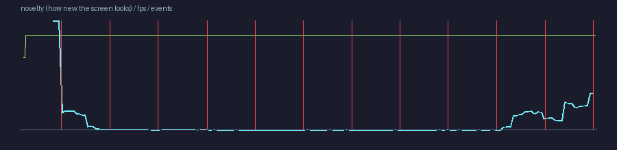
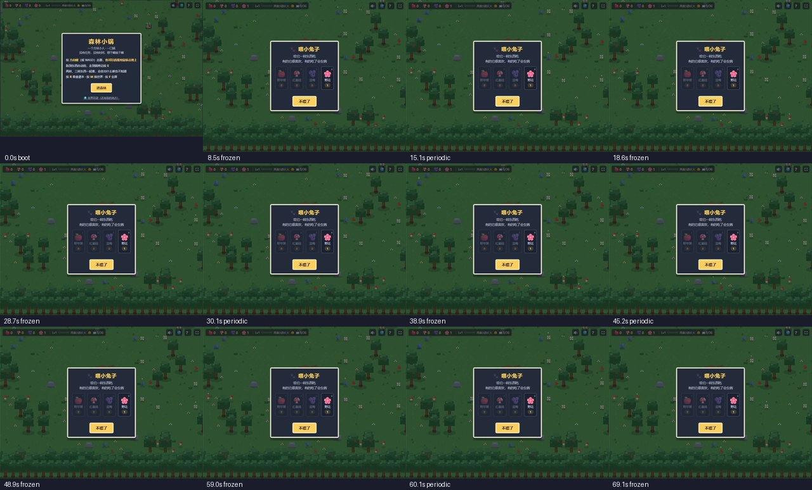

# Playtest report — ROUGH

- policy **explorer**, 120.1s, telemetry: False
- FPS avg 60.0 / p5 60 / min 46
- events: {} · deaths 0 · wins 0 · first event at Nones
- explored 0 map cells · mean novelty 0.0043

## Issues

- **[major]** Input had no visible effect — screen unchanged for 6s while input was held (t=8.5s) 
- **[major]** Input had no visible effect — screen unchanged for 6s while input was held (t=18.6s) 
- **[major]** Input had no visible effect — screen unchanged for 6s while input was held (t=28.7s) 
- **[major]** Input had no visible effect — screen unchanged for 6s while input was held (t=38.9s) 
- **[major]** Input had no visible effect — screen unchanged for 6s while input was held (t=48.9s) 
- **[major]** Input had no visible effect — screen unchanged for 6s while input was held (t=59.0s) 
- **[major]** Input had no visible effect — screen unchanged for 6s while input was held (t=69.1s) 
- **[major]** Input had no visible effect — screen unchanged for 6s while input was held (t=79.2s) 
- **[major]** Input had no visible effect — screen unchanged for 6s while input was held (t=89.2s) 
- **[major]** Input had no visible effect — screen unchanged for 6s while input was held (t=99.3s) 
- **[major]** Input had no visible effect — screen unchanged for 6s while input was held (t=109.4s) 
- **[major]** Input had no visible effect — screen unchanged for 6s while input was held (t=119.5s) 
- **[design]** Low-novelty stretch (likely boring) — 9s–114s: the screen barely changed and nothing happened (t=8.67s)

