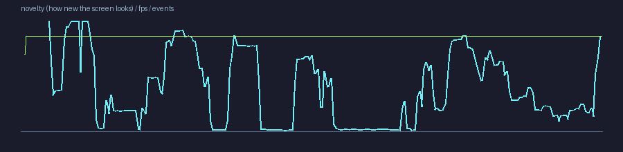
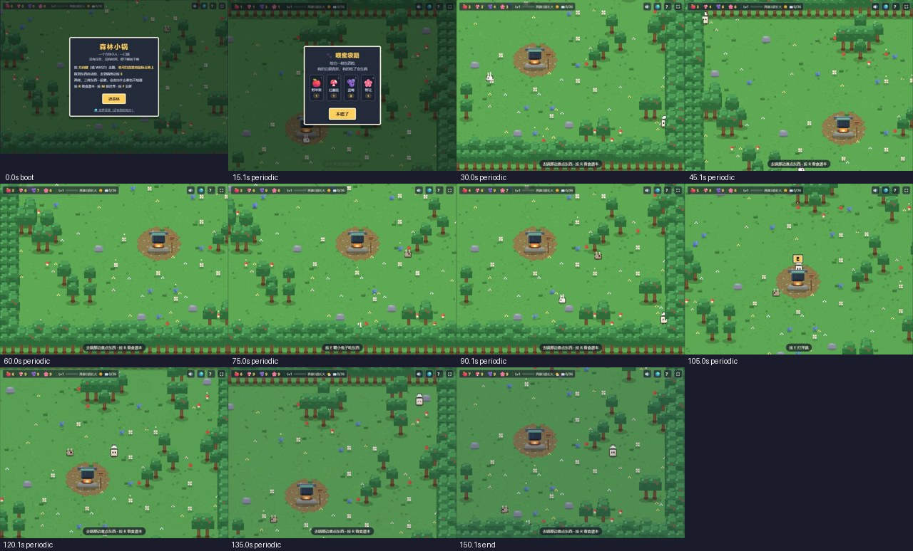

# Playtest report — PLAYABLE

- policy **explorer**, 150.1s, telemetry: True
- FPS avg 60.0 / p5 60 / min 49
- events: {} · deaths 0 · wins 0 · first event at Nones
- explored 95 map cells · mean novelty 0.0218

## Issues

- **[design]** Nothing happens — 0s–150s: 150s of play with no game event (no pickup, fight, damage or progress) (t=0.0s)
- **[design]** Low-novelty stretch (likely boring) — 81s–99s: the screen barely changed and nothing happened (t=80.75s)

