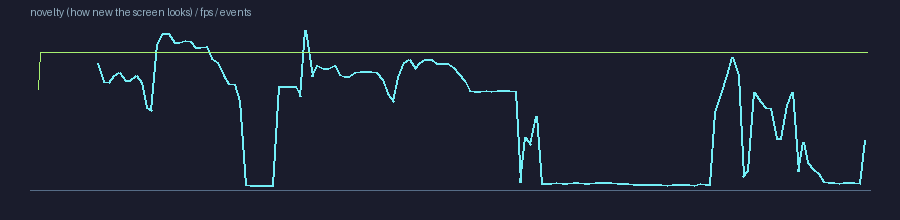
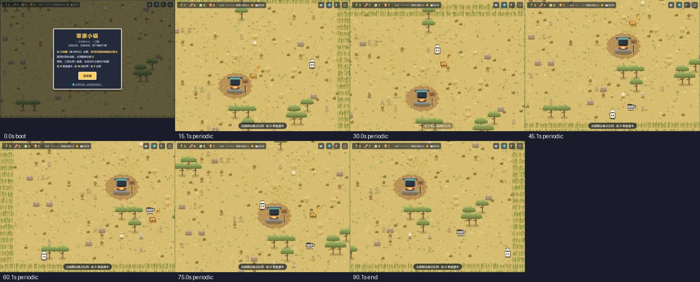

# Playtest report — PLAYABLE

- policy **explorer**, 90.1s, telemetry: True
- FPS avg 60.0 / p5 60 / min 44
- events: {'pickup': 22} · deaths 0 · wins 0 · first event at 6.9s
- explored 76 map cells · mean novelty 0.0232

## Issues

- **[design]** Nothing happens — 52s–74s: 22s of play with no game event (no pickup, fight, damage or progress) (t=52.3s)
- **[design]** Low-novelty stretch (likely boring) — 55s–72s: the screen barely changed and nothing happened (t=54.83s)

