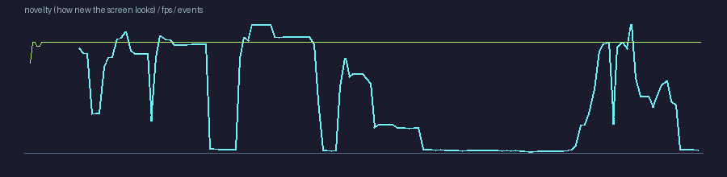
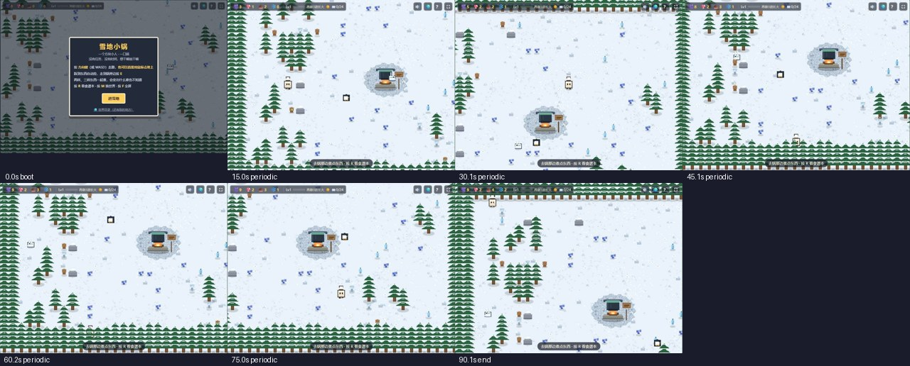

# Playtest report — PLAYABLE

- policy **explorer**, 90.1s, telemetry: True
- FPS avg 60.0 / p5 60 / min 49
- events: {'pickup': 17, 'bagfull': 3} · deaths 0 · wins 0 · first event at 1.3s
- explored 69 map cells · mean novelty 0.05

## Issues

- **[design]** Nothing happens — 47s–72s: 25s of play with no game event (no pickup, fight, damage or progress) (t=46.8s)
- **[design]** Low-novelty stretch (likely boring) — 53s–70s: the screen barely changed and nothing happened (t=52.92s)

