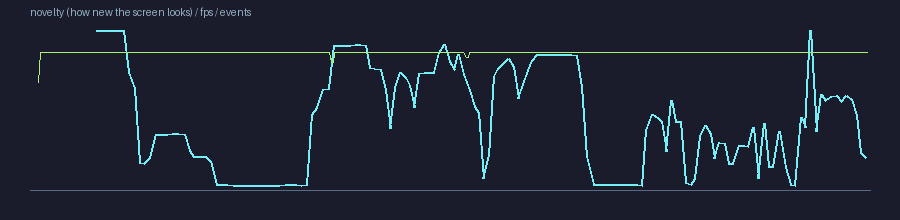
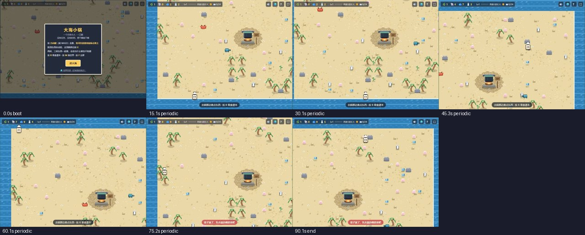

# Playtest report — PLAYABLE

- policy **explorer**, 90.1s, telemetry: True
- FPS avg 59.9 / p5 60 / min 47
- events: {'pickup': 24, 'bagfull': 2} · deaths 0 · wins 0 · first event at 1.9s
- explored 74 map cells · mean novelty 0.0383

## Issues

- **[design]** Low-novelty stretch (likely boring) — 20s–30s: the screen barely changed and nothing happened (t=20.0s)

